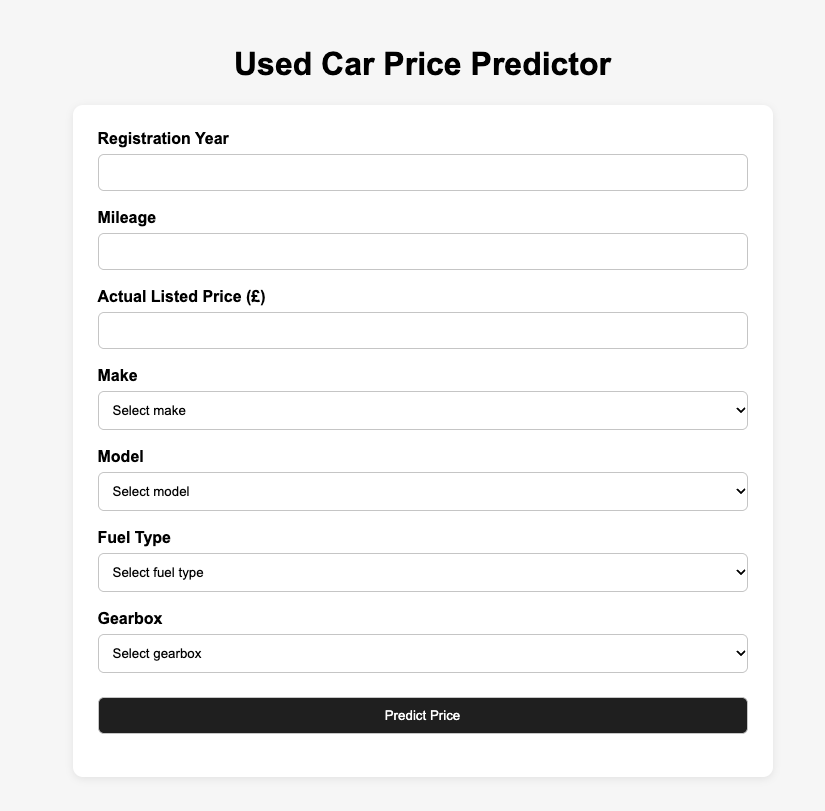
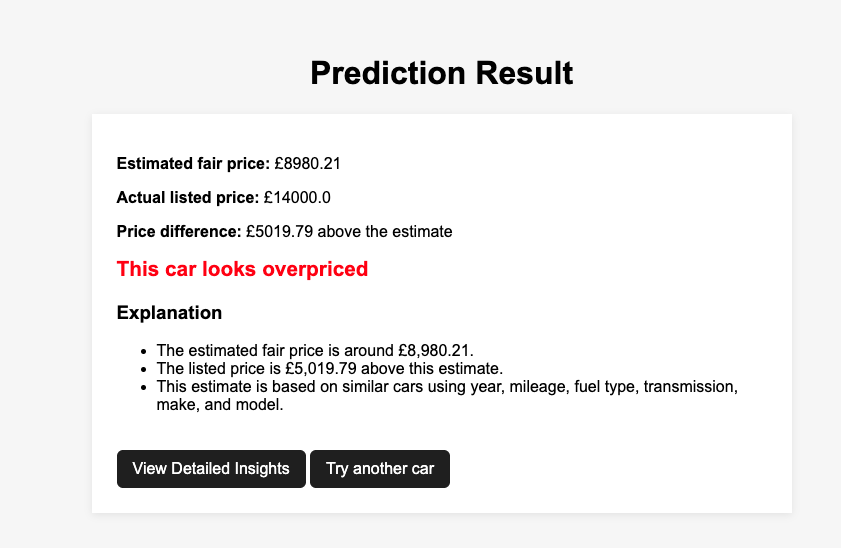
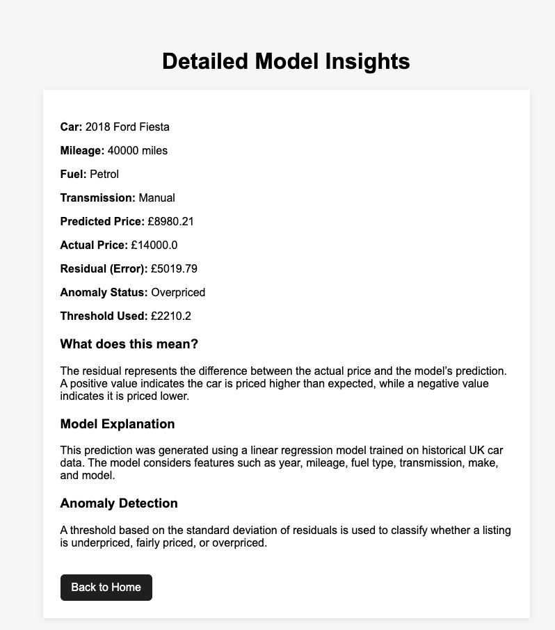

# Used Car Price Prediction System

**Machine learning web application for estimating UK used-car prices and comparing them with advertised prices.**

Built as my final-year BSc Computer Science & Artificial Intelligence project, this application combines data preparation, regression modelling and a Flask interface to help users assess whether a used-car listing is priced close to a model-generated estimate.

> **Project status:** Completed university project, with a subsequent correction to categorical encoding in the web prediction flow. This is an educational prototype, not a professional vehicle valuation service.

## Features

- **Price estimation:** Enter a vehicle's make, model, registration year, mileage, fuel type and transmission to receive a predicted price.
- **Listing comparison:** Compare the prediction against an advertised price entered by the user.
- **Pricing classification:** Label the listing **Overpriced**, **Underpriced** or **Fairly Priced** using a residual-based threshold.
- **Model insights:** View the selected vehicle details, estimated price, listed price, difference and threshold in a separate insights page.
- **Dependent selections:** Vehicle options are populated from combinations found in the dataset.

## Application screenshots

### Vehicle prediction form


### Price prediction result


### Detailed model insights


## Technologies

| Technology | Purpose |
| --- | --- |
| Python | Data preparation, modelling and application logic |
| Pandas / NumPy | Data cleaning, transformations and numerical operations |
| scikit-learn | Train-test splitting, regression modelling and evaluation |
| Flask | Web routes, form handling and HTML rendering |
| HTML / CSS | User interface |
| Matplotlib / Seaborn | Exploratory data analysis and visualisations |

## Dataset and preprocessing

The application uses a UK used-car CSV dataset obtained through Kaggle. A related [Kaggle notebook and its input page](https://www.kaggle.com/code/alkidiarete/usedcar-in-uk-mlp/input) informed the dataset reference; the original dataset listing should be linked separately when confirmed.

The preprocessing workflow:

1. Loads `data/raw/used_cars_UK.csv` and removes selected unused columns.
2. Renames fields into consistent names, including `selling_price`, `mileage`, `year`, `fuel` and `transmission`.
3. Converts numeric fields and removes records missing required values.
4. Extracts make and model from the vehicle title.
5. One-hot encodes categorical predictors for regression.

The model uses six input fields: **year, mileage, fuel type, transmission, make and model**. Other details such as vehicle condition, location and service history are not included in its predictions.

## Machine learning methodology

### Model selection

I selected **Multiple Linear Regression** as the main model because its interpretability made it a useful baseline for understanding how vehicle characteristics relate to prices. Given the project's timeframe, I prioritised building, evaluating and integrating a working model into a web application rather than conducting an extensive search across more complex algorithms.

The separate UK training script also includes an experiment with **Ridge Regression**. The Flask application uses **Linear Regression**, not Ridge.

### Training and evaluation

- **Target:** Vehicle selling price in pounds sterling.
- **Predictors:** Year, mileage, fuel type, transmission, make and model.
- **Split:** 80% training / 20% testing, using `random_state=42`.
- **Reported UK Linear Regression results:**

| Metric | Reported result |
| --- | ---: |
| R² | Approximately **0.793** |
| Mean Absolute Error (MAE) | Approximately **£1,301** |

An R² of 0.793 indicates that the model explained approximately 79.3% of the variation in prices in the evaluated test data. An MAE of £1,301 means its predictions differed from actual test prices by about £1,301 on average, in absolute terms. These are historical project results and may differ if the model is retrained with different data or dependencies.

### Pricing classification

The app calculates the difference between the advertised price and its prediction:

```text
residual = listed_price - predicted_price
```

It uses the standard deviation of test-set residuals as a threshold:

- **Overpriced:** residual is greater than the threshold.
- **Underpriced:** residual is less than the negative threshold.
- **Fairly Priced:** residual is within the threshold range.

These labels are **model-based comparisons**, not verified market valuations or a formal statistical anomaly-detection model.

## Project structure

```text
app/
  main.py                 # Flask routes, model training and predictions
  templates/              # Homepage, result and insights views
  static/                 # CSS
src/
  original_data/          # Earlier preprocessing, EDA and training scripts
  uk_data/                # UK preprocessing, EDA and model evaluation scripts
data/raw/                 # CSV datasets
notebooks/                # Reference notebook
reports/figures/          # EDA charts
models/                   # Placeholder; no trained model artifact is committed
screenshots/              # README screenshots
requirements.txt
README.md
```

## Installation and local setup

**Requirements:** Python and pip. This project has been run locally with Python 3.14, although package compatibility may vary across environments.

1. Clone the repository and enter the project folder:

   ```bash
   git clone https://github.com/PNT927/used_car_price_prediction.git
   cd used_car_price_prediction
   ```

2. Create and activate a virtual environment (macOS/Linux):

   ```bash
   python3 -m venv .venv
   source .venv/bin/activate
   ```

3. Install the dependencies:

   ```bash
   python -m pip install -r requirements.txt
   ```

4. Start Flask **from the `app` directory**, because the current application loads the dataset using a relative path:

   ```bash
   cd app
   python main.py
   ```

5. Open `http://127.0.0.1:5000/` in your browser.

> **Local development only:** The Flask application currently uses debug mode and a development secret key. Do not deploy this configuration publicly without updating the security and deployment settings.

## How to use

1. Select the vehicle make and model.
2. Enter the registration year, mileage, fuel type and transmission.
3. Enter the advertised price.
4. Submit the form to see the estimated price and pricing classification.
5. Open **Detailed Model Insights** for the difference and classification threshold.

## Challenges and lessons learned

- **Balancing interpretability and scope:** A linear model made it possible to establish an understandable baseline while completing the end-to-end application within the dissertation timeframe.
- **Preparing categorical data consistently:** After the university project, testing two different vehicle makes revealed that one-row dummy encoding in the Flask prediction route was discarding categorical information. The prediction input was corrected to retain the selected category before aligning with training columns.
- **Connecting modelling with a usable interface:** Building the Flask application required translating model inputs and residual calculations into results that a non-technical user could understand.

## Limitations

- The dataset is static, so estimates may not reflect current market prices.
- Condition, accident history, service records and location are not fully represented.
- Linear Regression may not capture complex or non-linear relationships.
- Make and model are extracted from vehicle title text, which is a simplified approach.
- The application retrains its model when it starts instead of loading a versioned saved model.
- The pricing threshold is a simple heuristic based on test residual variation; it does not quantify prediction confidence.

## Future improvements

- Compare Random Forest and Gradient Boosting against the linear baseline.
- Build a reusable preprocessing and prediction pipeline for consistent feature encoding.
- Save and load a trained model instead of retraining at startup.
- Add automated tests for vehicle inputs, categorical encoding and prediction routes.
- Explore updated marketplace data and regional pricing features.
- Improve deployment configuration and user-facing validation.

## Author

**Philip Tagoe Jr**
BSc Computer Science & Artificial Intelligence — University of Sussex
